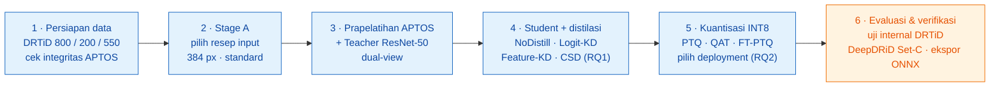
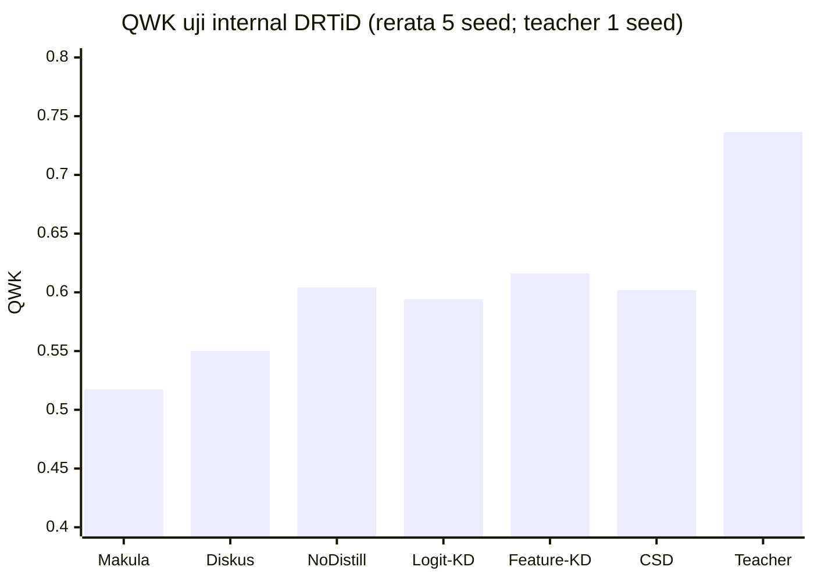

<div align="center">


# DR-VERGE

### View-Evidence Relational Grading Engine

**_Complementarity-Shift Distillation_ dan Kuantisasi INT8 untuk _Grading_ Retinopati Diabetik pada Fundus _Dual-View_**

**🇮🇩 Bahasa Indonesia** · [🇬🇧 English](README.en.md)

<br />

[](https://gemastik.kemdiktisaintek.go.id/landing/tentang)
[](#)
[](https://sdgs.un.org/goals/goal3)
[](https://dr-verge.vercel.app)

[](https://www.python.org/)
[](https://pytorch.org/)
[](https://onnxruntime.ai/)
[](https://colab.research.google.com/)
[](https://react.dev/)
[](https://vitejs.dev/)
[](https://www.typescriptlang.org/)
[](https://tailwindcss.com/)

[](experiments/results/tables/table_gate_report.csv)
[](experiments/results/tables/table_results_audit.csv)
[](experiments/results/tables/table_efficiency.csv)
[](experiments/results/tables/table_efficiency.csv)
[](#-keterbatasan-dan-penafian)
[](#-keterbatasan-dan-penafian)

</div>

> [!IMPORTANT]
> **Prototipe riset, bukan alat medis.** Seluruh angka di repositori ini adalah artefak penelitian yang dihasilkan di bawah protokol evaluasi yang dikunci sejak awal. Tidak ada keluaran yang tervalidasi untuk penggunaan klinis, dan tidak ada hasil yang boleh menggantikan pemeriksaan oleh dokter spesialis mata.

---

## 📑 Daftar Isi

- [Ringkasan](#-ringkasan)
- [Latar Belakang](#-latar-belakang)
- [Gagasan Utama: _Complementarity-Shift Distillation_](#-gagasan-utama-complementarity-shift-distillation)
- [Pertanyaan Penelitian](#-pertanyaan-penelitian)
- [Arsitektur dan Alur Penelitian](#-arsitektur-dan-alur-penelitian)
- [Data dan Protokol Eksperimen](#-data-dan-protokol-eksperimen)
- [Hasil Utama](#-hasil-utama)
- [Keterbatasan dan Penafian](#-keterbatasan-dan-penafian)
- [Kontribusi](#-kontribusi)
- [Struktur Repositori](#-struktur-repositori)
- [Reproduksi Eksperimen](#-reproduksi-eksperimen)
- [Demo Web](#-demo-web)
- [Tim](#-tim)
- [Sitasi](#-sitasi)

---

## ✨ Ringkasan

DR-VERGE adalah kerangka _grading_ retinopati diabetik (DR) lima tingkat berbasis **dua citra fundus dari mata yang sama** — satu berpusat pada **makula**, satu berpusat pada **diskus optik**. Kerangka ini menggabungkan pemodelan ordinal **CORAL**, _lightweight knowledge distillation_, metode distilasi baru bernama **_Complementarity-Shift Distillation_ (CSD)**, serta **kuantisasi INT8** agar model dapat berjalan cepat di CPU.

<div align="center">

| 🎯 QWK _teacher_ | 🪶 QWK _student_ CSD | 📦 Ukuran model INT8 | ⚡ Latensi CPU | 🗜️ Lebih kecil dari _teacher_ | 🚀 Lebih cepat dari _teacher_ |
|:---:|:---:|:---:|:---:|:---:|:---:|
| **0,7364** | **0,6018** | **0,9507 MB** | **11,35 ms** | **162,1×** | **55,3×** |

</div>

- **Premis _dual-view_ terbukti** — _student_ yang membaca dua _view_ (QWK 0,6042) mengungguli _student_ yang hanya membaca makula (0,5175) atau diskus optik (0,5502).
- **RQ1 — disosiasi yang jujur.** CSD paling selaras dengan _prediction shift_ milik _teacher_ pada ketiga metrik (ShiftL1 0,3509 · CosAgree 0,4361 · BenefitCorr 0,3075), tetapi perbedaan QWK terhadap NoDistill, Logit-KD, dan Feature-KD **tidak signifikan secara statistik**.
- **RQ2 — kompresi yang bertahan.** QAT INT8 mempertahankan **98,96%** QWK _student_ FP32 dengan artefak **< 1 MB** dan latensi **11,35 ms** pada satu _thread_ CPU.
- **Generalisasi eksternal.** Pada DeepDRiD Set-C, _student_ FP32 mempertahankan **84,4%** QWK _teacher_.
- **Dapat diaudit.** Pipeline memverifikasi dirinya sendiri: **36/36 _integrity gates_ lulus** dan **265/265 angka utama** cocok saat dihitung ulang dari prediksi per sampel.

---

## 🩺 Latar Belakang


Sekitar **589 juta** orang dewasa hidup dengan diabetes pada 2024 dan jumlahnya diproyeksikan mencapai **853 juta** pada 2050. Prevalensi DR pada penyandang diabetes mencapai **22,27%**, dengan jumlah penderita diperkirakan naik dari **103,12 juta** (2020) menjadi **160,50 juta** (2045). Di Indonesia, tenaga dan sarana kesehatan mata masih terkonsentrasi di kota besar, sementara kondisi geografis kepulauan dan wilayah **3T** (tertinggal, terdepan, terluar) mempersulit akses skrining.

Satu citra fundus (_single-field_) memiliki cakupan retina terbatas dan dapat melewatkan lesi di luar area yang terpotret. Pendekatan **_two-field_** — citra berpusat makula dan diskus optik dari mata yang sama — memperluas cakupan informasi, tetapi model _dual-view_ yang akurat cenderung berat. DR-VERGE menjawab pertanyaan yang belum banyak diteliti:

> **Ketika model _dual-view_ dikompresi, apakah keuntungan spesifik dari menggabungkan dua _view_ ikut bertahan — atau justru menjadi hal pertama yang hilang?**

Penelitian ini mendukung **SDG 3** (kehidupan sehat dan kesejahteraan), selaras dengan **Asta Cita keempat RPJMN 2025–2029**, dan menjawab tema GEMASTIK XIX 2026: inovasi TIK yang _"Berdampak, Inklusif, dan Berkelanjutan menuju Masyarakat Cerdas"_.

<div align="center">

<br />
<sub><b>Gambar 1.</b> Satu mata yang sama dari DRTiD: (a) citra berpusat makula dan (b) citra berpusat diskus optik. Kedua <i>field</i> hanya tumpang-tindih sebagian, sehingga masing-masing menangkap area retina yang tidak terlihat pada yang lain.</sub>
</div>

---

## 💡 Gagasan Utama: _Complementarity-Shift Distillation_

Model _teacher_ menghasilkan tiga prediksi ordinal: dari _view_ makula, dari _view_ diskus optik, dan dari gabungan keduanya (_joint dual-view_). Dengan CORAL, setiap prediksi berbentuk empat probabilitas kumulatif:

$$
\mathbf{p} = \big[\,P(y>0),\; P(y>1),\; P(y>2),\; P(y>3)\,\big]
$$

**_Prediction shift_** adalah perubahan bertanda ketika model berpindah dari rata-rata dua prediksi _individual-view_ menuju prediksi _joint dual-view_:

$$
\bar{\mathbf{p}} = \frac{\mathbf{p}_{\text{mac}} + \mathbf{p}_{\text{disc}}}{2}, \qquad \Delta = \mathbf{p}_{\text{dual}} - \bar{\mathbf{p}}
$$

Δ **bukan** prediksinya — Δ adalah _apa yang "dibeli" oleh view kedua_: arah dan besar perubahan keputusan _teacher_. CSD melatih _student_ agar meniru perubahan tersebut, bukan sekadar meniru keluaran akhirnya:

$$
\mathcal{L}_{\text{CSD}} = \frac{1}{N}\sum_{i=1}^{N} \text{SmoothL1}\!\left(\frac{\Delta_i^{S}}{s},\, \frac{\Delta_i^{T}}{s}\right), \qquad s = \mathbb{E}_{\text{train}}\big[\,|\Delta^{T}|\,\big] = 0{,}1073
$$

Skala global _s_ dihitung **sekali** dari _teacher_ yang dibekukan pada seluruh data latih agar skala _loss_ stabil. Fungsi _loss_ total _student_:

$$
\mathcal{L} = \mathcal{L}_{\text{CORAL}} + \lambda\,\mathcal{L}_{\text{aux}} + \alpha\,\mathcal{L}_{\text{logitKD}} + \beta\,\mathcal{L}_{\text{CSD}}, \qquad \lambda = 0{,}5,\;\; \alpha = 0{,}5,\;\; \tau = 2,\;\; \beta = 0{,}1
$$

> [!NOTE]
> Δ diperlakukan sebagai **_operational prediction-shift proxy_** — ukuran perilaku prediksi model — dan **tidak** mengukur komplementaritas anatomis atau biologis retina secara langsung.

---

## ❓ Pertanyaan Penelitian

| | Pertanyaan | Jawaban singkat |
|:---:|---|---|
| **RQ1** | Sejauh mana CSD dapat mentransfer _prediction shift_ dari _teacher_ ke _lightweight student_ dibandingkan NoDistill, Logit-KD, dan Feature-KD? | **Disosiasi** — CSD terbaik secara deskriptif pada ketiga metrik _shift fidelity_, tetapi tidak unggul signifikan pada QWK |
| **RQ2** | Sejauh mana PTQ dan QAT INT8 memengaruhi retensi QWK, ukuran artefak, dan latensi inferensi CPU pada model ringan terpilih? | **QAT mempertahankan 98,96% QWK**, artefak 0,9507 MB, 11,35 ms — 162,1× lebih kecil dan 55,3× lebih cepat dari _teacher_ |

---

## 🏗️ Arsitektur dan Alur Penelitian

<div align="center">

<br />
<sub><b>Gambar 2.</b> Arsitektur DR-VERGE: <i>teacher</i> ResNet-50 <i>dual-view</i>, <i>lightweight student</i> dengan InteractionFusion, CSD, dan optimasi <i>deployment</i> PTQ/QAT INT8.</sub>
</div>

<br />

| Komponen | _Teacher_ | _Student_ |
|---|---|---|
| _Backbone_ | ResNet-50 (_shared weights_ antar-_view_) | _Custom depthwise-separable CNN_ (_shared weights_) |
| Prapelatihan | APTOS 2019 | APTOS 2019 |
| Fusi | InteractionFusion atas $[\,z_m,\; z_d,\; \lvert z_m - z_d\rvert,\; z_m \odot z_d\,]$ | Sama |
| _Head_ | 3 CORAL _heads_ (makula · diskus · _dual_) | Sama |
| Parameter | 40.313.932 | **328.588** |

**Grade DR bersifat ordinal, dan kodenya memperlakukannya demikian.** CORAL menghasilkan probabilitas kumulatif yang monoton, dan _grade_ akhir adalah **jumlah _threshold_ yang terlampaui** — bukan _argmax_. Salah membaca _grade_ 3 sebagai _grade_ 0 jauh lebih berbahaya daripada sebagai _grade_ 2, sehingga **Quadratic Weighted Kappa (QWK)** dipakai sebagai metrik utama.

Alur penelitian terdiri atas enam tahap. **Seluruh keputusan diambil hanya dari data validasi**; data uji internal dan data eksternal baru dibuka setelah semuanya dikunci.



---

## 🗂️ Data dan Protokol Eksperimen

| Dataset | Peran | Ukuran |
|---|---|---|
| **DRTiD** | Utama — pelatihan, validasi, dan uji internal | 1.550 _examined-eye records_ · 3.100 citra _dual-view_ · _grade_ 0–4 |
| **APTOS 2019** | Prapelatihan _backbone_ | 3.662 citra _single-view_ (2.930 latih · 366 validasi) |
| **DeepDRiD** | Evaluasi konfirmatori eksternal | Set-C: 100 pasien · 200 mata · 400 citra |

| Partisi DRTiD | Mata | _Grade_ 0 | _Grade_ 1 | _Grade_ 2 | _Grade_ 3 | _Grade_ 4 |
|---|---:|---:|---:|---:|---:|---:|
| Latih | 800 | 386 | 72 | 208 | 104 | 30 |
| Validasi | 200 | 96 | 18 | 52 | 26 | 8 |
| Uji internal | 550 | 265 | 50 | 146 | 69 | 20 |

**Protokol yang dikunci sebelum eksekusi:**

- **Pembagian data** — partisi resmi DRTiD dipakai apa adanya; 1.000 _record_ latih dibagi terstratifikasi menjadi 800/200 (_seed_ 42). DRTiD **tidak memiliki pengenal pasien**, sehingga unit sampel internal adalah _examined-eye record_.
- **Stage A** — empat resep (224/384 × _standard_/_balanced sampling_) dibandingkan tanpa distilasi pada tiga _seed_. Terpilih **384 × 384, _standard sampling_** (QWK validasi 0,6491 vs 0,5549).
- **Augmentasi** — rotasi ±15° (p = 0,7) dengan transformasi geometris yang sama pada kedua _field_; kecerahan/kontras ±0,15 (p = 0,5) secara independen per _field_.
- **_Seed_** — _tuning_ {42, 123, 2026}; perbandingan utama lima _core seeds_ {42, 123, 2026, 3407, 8888}.
- **_Threshold_ keputusan** — satu _threshold_ global per kondisi dari rentang 0,35–0,65 (langkah 0,05), dipilih pada validasi.
- **Pemilihan metode** — rerata QWK validasi lima _seed_; selisih < 0,005 dianggap seri, dengan urutan penentu Macro-F1 → _severe error rate_ → MAE → kompleksitas.
- **Statistik** — 10.000 replikasi _hierarchical paired cluster bootstrap_ + 10.000 iterasi _paired permutation_, dengan koreksi Holm per keluarga hipotesis. **Selisih yang interval kepercayaan 95%-nya memuat nol tidak diklaim.**
- **Kuantisasi** — _eager static quantization_ (engine x86) pada _backbone_; InteractionFusion dan CORAL _heads_ tetap FP32 (_mixed precision_). Kalibrasi PTQ deterministik pada 800 _record_ latih; QAT _learning rate_ 3 × 10⁻⁵.
- **Kriteria _deployment_** — retensi QWK validasi ≥ 95% dan _severe error_ tidak memburuk secara kredibel; di antara kandidat yang lolos dipilih latensi median terendah. Ambang 95% adalah kriteria rekayasa, **bukan** margin non-inferioritas klinis.
- **Latensi** — _batch size_ 1, satu _thread_ CPU, 50 inferensi pemanasan, lima blok × 500 inferensi, median.

Eksperimen final dijalankan di Google Colab dengan **NVIDIA A100-SXM4-80GB**, CPU host Intel Xeon @ 2,20 GHz, **PyTorch 2.11.0+cu128**.

---

## 📊 Hasil Utama

Seluruh angka berasal dari satu run final (`enhanced_v1_20260811`) yang tersimpan utuh di [`experiments/results/`](experiments/results/). Setiap gambar disertai berkas `*_data.csv` berisi angka penyusunnya.

### 1. Premis _dual-view_ terpenuhi



Pada validasi, prediksi _joint dual-view_ _teacher_ mengungguli _auxiliary head_ _single-view_ terbaiknya sebesar **+0,0469 QWK**, dan _teacher_ menunjukkan _prediction shift_ yang terukur — sinyal yang menjadi target CSD.

<div align="center">

</div>

### 2. RQ1 — Performa prediktif (550 mata uji internal DRTiD)

| Model / Kondisi | QWK ↑ | Macro-F1 ↑ | MAE ↓ | SER ↓ |
|---|---:|---:|---:|---:|
| ResNet-50 _teacher_ (_dual-view_, 1 _seed_) | 0,7364 | 0,3887 | 0,5909 | 0,1764 |
| _Student_, hanya makula | 0,5175 ± 0,0193 | 0,3330 ± 0,0239 | 0,8524 ± 0,0240 | 0,2742 ± 0,0084 |
| _Student_, hanya diskus optik | 0,5502 ± 0,0067 | 0,3422 ± 0,0139 | 0,8047 ± 0,0108 | 0,2549 ± 0,0122 |
| _Dual-view_, tanpa distilasi | 0,6042 ± 0,0166 | 0,3355 ± 0,0119 | 0,8105 ± 0,0316 | 0,2505 ± 0,0127 |
| Logit-KD | 0,5942 ± 0,0290 | **0,3589 ± 0,0278** | 0,7775 ± 0,0646 | 0,2487 ± 0,0187 |
| Logit-KD + Feature-KD | **0,6161 ± 0,0101** | 0,3435 ± 0,0113 | **0,7702 ± 0,0278** | **0,2396 ± 0,0107** |
| **Logit-KD + CSD (DR-VERGE)** | 0,6018 ± 0,0149 | 0,3362 ± 0,0152 | 0,7902 ± 0,0250 | 0,2582 ± 0,0081 |

<sub>_Student_: rerata ± simpangan baku lima _core seeds_. SER = _severe error rate_, P(|y − ŷ| ≥ 2). Nilai tebal = terbaik di antara _student_.</sub>

Dibandingkan _teacher_, CSD mempertahankan **81,7%** QWK dengan **122,7× lebih sedikit parameter**. Perbandingan berpasangan terhadap ketiga pembanding:

| Perbandingan | ΔQWK | CI 95% | p (permutasi) | p (Holm) | Kesimpulan |
|---|---:|---|---:|---:|---|
| CSD vs tanpa distilasi | −0,0024 | [−0,0336; +0,0285] | 0,8003 | 0,8003 | tidak signifikan |
| CSD vs Logit-KD | +0,0077 | [−0,0304; +0,0463] | 0,3640 | 0,7279 | tidak signifikan |
| CSD vs Feature-KD | −0,0143 | [−0,0445; +0,0153] | 0,1650 | 0,4950 | tidak signifikan |

<div align="center">

</div>

### 3. RQ1 — Fidelitas transfer mekanisme

CSD menghasilkan **ShiftL1 terendah serta CosAgree dan BenefitCorr tertinggi** — pola monoton yang konsisten, dan formulasi utama juga mengungguli ketiga varian ablasi.

| Kondisi / Formulasi | QWK | ShiftL1 ↓ | CosAgree ↑ | BenefitCorr ↑ |
|---|---:|---:|---:|---:|
| _Dual-view_, tanpa distilasi | 0,6042 | 0,3759 | 0,3509 | 0,2193 |
| Logit-KD | 0,5942 | 0,3840 | 0,2858 | 0,1795 |
| Logit-KD + Feature-KD | 0,6161 | 0,3718 | 0,3815 | 0,1943 |
| **Logit-KD + CSD (DR-VERGE)** | 0,6018 | **0,3509** | **0,4361** | **0,3075** |
| Ablasi: tanpa penskalaan (_raw-Huber_, 3 _seed_) | 0,6178 | 0,3746 | 0,4017 | 0,2036 |
| Ablasi: KL-_softmax_, kontrol negatif (3 _seed_) | 0,6099 | 0,3885 | 0,3274 | 0,1082 |
| Ablasi: _counterfactual_ kepala sama (3 _seed_) | 0,6128 | 0,3576 | 0,4327 | 0,2544 |

<div align="center">

</div>

> [!TIP]
> **Kedua sisi adalah temuan.** Mekanisme berhasil ditransfer, tetapi akurasi tidak ikut meningkat secara signifikan. Fidelitas terhadap _prediction shift_ dan performa prediktif ternyata **tidak bergerak sejalan**, sehingga keduanya perlu dievaluasi sebagai dua aspek yang berbeda.

### 4. RQ2 — Efisiensi dan kuantisasi

| Model | Parameter | Ukuran (MB) | Latensi CPU (ms) | Retensi QWK | ΔQWK vs FP32 [CI 95%] |
|---|---:|---:|---:|---:|---|
| ResNet-50 _teacher_ | 40.313.932 | 154,089 | 627,610 | — | — |
| _Student_ FP32 (M\*, CSD) | 328.588 | 1,2935 | 32,490 | 100,00% | — |
| _Student_ PTQ INT8 | 328.588 | **0,9507** | **11,238** | 97,27% | −0,0164 [−0,0360; +0,0023] |
| **_Student_ QAT INT8 (_deployment_)** | 328.588 | **0,9507** | 11,347 | **98,96%** | **−0,0063** [−0,0293; +0,0175] |

QAT INT8 adalah satu-satunya kandidat yang lolos kriteria retensi validasi 95% (99,04% vs PTQ 93,37%), sehingga dipilih dan dikunci sebagai artefak _deployment_ **sebelum** data uji dibuka. Interval kepercayaan kedua varian memuat nol; namun uji permutasi terkoreksi Holm menunjukkan perbedaan PTQ vs FP32 (p = 0,0243), sedangkan QAT tidak (p Holm = 0,4854). Ketika kedua prosedur tidak sepakat, **keduanya dilaporkan dan tidak ada yang diklaim**.

<table>
<tr>
<td width="50%"></td>
<td width="50%"></td>
</tr>
<tr>
<td align="center"><sub><i>Trade-off</i> QWK vs latensi CPU</sub></td>
<td align="center"><sub>Ukuran artefak dan latensi</sub></td>
</tr>
</table>

### 5. Generalisasi eksternal — DeepDRiD Set-C

Model **dibekukan** — tanpa _fine-tuning_, tanpa penyetelan _threshold_. Interval _bootstrap_ dikelompokkan per **pasien**.

| Model | QWK Set-C |
|---|---:|
| ResNet-50 _teacher_ (1 _seed_) | 0,7923 [0,7152; 0,8550] |
| _Student_ PTQ INT8 | **0,6729 ± 0,0365** |
| _Student_ FP32 (M\*) | 0,6688 ± 0,0415 |
| _Fine-tune_ FP32 (kontrol) | 0,6567 ± 0,0364 |
| _Student_ FT-PTQ INT8 | 0,6513 ± 0,0315 |
| _Student_ QAT INT8 (_deployment_) | 0,6344 ± 0,0326 |

_Student_ FP32 mempertahankan **84,4%** QWK _teacher_ pada domain eksternal. Pada Set-C urutannya berbalik: QAT lebih rendah daripada PTQ (ΔQWK −0,0384, CI 95% [−0,0826; −0,0006]). Varian yang optimal pada validasi internal **belum tentu** terbaik di domain eksternal — pilihan pra-registrasi tetap dipertahankan, karena mengubahnya setelah melihat data eksternal akan menghilangkan makna set konfirmatori.

<div align="center">

</div>

<details>
<summary><b>🖼️ Galeri lengkap 14 gambar hasil</b></summary>

<br />

| | |
|:---:|:---:|
| <br/><sub>01 · Dataset</sub> | <br/><sub>02 · Performa</sub> |
| <br/><sub>03 · Keamanan ordinal</sub> | <br/><sub>04 · _Recall_ per _grade_</sub> |
| <br/><sub>05 · Matriks konfusi</sub> | <br/><sub>06 · _Dual-view gain_</sub> |
| <br/><sub>07 · Mekanisme CSD</sub> | <br/><sub>08 · Gradien CSD</sub> |
| <br/><sub>09 · Retensi kuantisasi</sub> | <br/><sub>10 · Efisiensi</sub> |
| <br/><sub>11 · Pareto</sub> | <br/><sub>12 · _Forest plot_</sub> |
| <br/><sub>13 · Eksternal Set-C</sub> | <br/><sub>14 · Internal vs eksternal</sub> |

</details>

---

## ⚠️ Keterbatasan dan Penafian

- **RQ1 tidak signifikan secara prediktif** — keunggulan CSD hanya pada fidelitas mekanisme, bukan QWK.
- **QWK absolut masih moderat** (_student_ 0,5942–0,6161) dan Macro-F1 rendah (0,3362 untuk CSD).
- **_Severe error rate_ 0,2582** — kira-kira satu dari empat mata meleset ≥ 2 _grade_.
- **_Recall grade_ 1 sangat rendah**, sehingga model tidak layak dipakai sebagai alat diagnosis mandiri.
- **Tanpa pengenal pasien di DRTiD** — pembagian dan _bootstrap_ internal berbasis mata, bukan pasien.
- **Evaluasi masih komputasional** — belum ada validasi prospektif, pengujian berbagai kamera fundus, pengujian pada perangkat CPU target, maupun uji klinis.
- **Tidak ada klaim generalitas** ke domain pencitraan lain.

DR-VERGE adalah prototipe riset dan **tidak ditujukan untuk diagnosis klinis mandiri**.

---

## 🧩 Kontribusi

1. **Algoritmik** — merumuskan CSD, yang memakai _signed joint-vs-individual cumulative ordinal prediction shift_ sebagai target distilasi; berbeda dari Logit-KD (keluaran akhir) maupun distilasi fitur/relasional.
2. **Pengukuran** — tiga metrik _shift fidelity_ (ShiftL1, CosAgree, BenefitCorr) plus kontrol _counterfactual_, sehingga transfer mekanisme diuji langsung, terpisah dari akurasi.
3. **Empiris** — uji terkontrol CSD vs NoDistill, Logit-KD, dan Feature-KD di bawah satu protokol pra-registrasi, dilaporkan apa adanya sebagai disosiasi.
4. **Praktis** — karakterisasi dampak INT8 pada _grader_ DR _dual-view_ ringan, menghasilkan model 0,95 MB / 11,35 ms yang berjalan di browser.

---

## 📁 Struktur Repositori

```text
DR-VERGE/
├── README.md                 dokumentasi utama (Bahasa Indonesia)
├── README.en.md              dokumentasi utama (English)
│
├── experiments/              eksperimen — kode dan bukti
│   ├── notebooks/            full_pipeline_notebook_enhanced.ipynb  ← notebook final
│   ├── results/              keluaran run final: tabel, gambar, prediksi per sampel, konfigurasi
│   ├── src/                  komponen modular: model, loss, dataset, prapelatihan
│   ├── configs/              konfigurasi YAML per kondisi pelatihan
│   ├── scripts/              make_splits.py + verification/
│   └── requirements.txt
│
├── research/                 argumen ilmiah, turunan matematis, catatan deployment, gambar paper
├── references/               literatur dan daftar pustaka
├── dataset/                  tata letak dan sumber dataset (data tidak di-commit)
└── frontend/                 demo web (React · Vite · TypeScript · ONNX Runtime Web)
```

Setiap direktori memiliki `README.md` (Indonesia) dan `README.en.md` (English) — atau `README.md` tunggal untuk direktori yang sudah stabil — yang menjelaskan isi dan fungsinya.

**Urutan membaca yang disarankan:**

1. Dokumen ini — gambaran utuh penelitian.
2. [`experiments/README.md`](experiments/README.md) — bagaimana eksperimen disusun dan dijalankan.
3. [`experiments/results/README.md`](experiments/results/README.md) — peta seluruh keluaran run final.
4. [`research/math.md`](research/math.md) — turunan matematis lengkap.
5. [`frontend/`](frontend/) — demo yang menjalankan model di browser.

---

## 🔁 Reproduksi Eksperimen

Seluruh eksperimen ada dalam **satu notebook mandiri**: [`experiments/notebooks/full_pipeline_notebook_enhanced.ipynb`](experiments/notebooks/full_pipeline_notebook_enhanced.ipynb). Notebook ini dirancang untuk **Google Colab** dan membaca data dari Google Drive.

**1. Siapkan dataset di Google Drive**

```text
MyDrive/DR-VERGE/
└── dataset/
    ├── DRTiD/                ← "Original Images/" + "Ground Truths/DR_grade/"
    ├── APTOS/
    └── DeepDRiD-master/      ← regular_fundus_images/
```

Lokasi DRTiD dan DeepDRiD dicari otomatis, sehingga notebook **tidak bergantung** pada tata letak repositori ini. Lihat [`dataset/README.md`](dataset/README.md) untuk sumber dan detail setiap dataset.

**2. Atur konfigurasi pada sel _Configuration_**

```python
DRIVE_BASE = "/content/drive/MyDrive/DR-VERGE"
RUN_TAG    = "enhanced_v1_YYYYMMDD"   # gunakan tag baru untuk setiap run baru
QUICK      = False                    # True = gladi singkat (1 seed, sedikit epoch)
RESUME     = True                     # lanjutkan run yang terputus pada RUN_TAG yang sama
USE_AMP    = False
```

**3. Jalankan seluruh sel (_Run All_)**

Disarankan gladi singkat dulu dengan `QUICK = True` pada `RUN_TAG` sementara. Run penuh membutuhkan **±12,5 jam pada A100**. Jika Colab terputus, buka kembali dengan `RUN_TAG` yang sama dan _Run All_ lagi — pekerjaan yang sudah selesai tidak dilatih ulang.

Run yang berhasil menulis `artifacts_<RUN_TAG>/FINAL_RUN_COMPLETE.txt` **hanya jika semua _blocking gate_ lulus**. Untuk lingkungan lokal:

```bash
pip install -r experiments/requirements.txt
```

Versi paket persis dari run final tercatat di [`experiments/results/configs/requirements_exact.txt`](experiments/results/configs/requirements_exact.txt).

### Integritas pipeline

Pipeline memverifikasi dirinya sendiri melalui **36 _integrity gates_** — skema data, keterpisahan partisi, kebenaran metrik, monotonisitas _head_ ordinal, kelengkapan _grid_ dan _seed_, kesetaraan cakupan kuantisasi PTQ/QAT/FT-PTQ, fidelitas ekspor ONNX, hingga prosedur statistik. Run yang gagal pada _blocking gate_ akan berhenti alih-alih melaporkan angka. _Gate_ terakhir menghitung ulang setiap angka utama dari berkas prediksi per sampel: **265/265 cocok**.

---

## 🌐 Demo Web

<div align="center">

[](https://dr-verge.vercel.app)

</div>

Prototipe web di [`frontend/`](frontend/) dibangun dengan React, Vite, TypeScript, Tailwind CSS, dan Recharts, dengan dua bahasa (Indonesia/English) serta tema monokrom dan berwarna. **Model berjalan sungguhan di browser** melalui `onnxruntime-web` — tanpa server, tanpa API, dan tidak ada citra yang meninggalkan perangkat pengguna. Konstanta _preprocessing_ dibaca dari `metadata.json` hasil ekspor, dan _grade_ dihitung sebagai jumlah _threshold_ CORAL yang terlampaui, persis seperti di notebook.

```bash
cd frontend
npm install
npm run dev
```

Detail lengkap: [`frontend/README.md`](frontend/README.md).

---

## 👥 Tim

<div align="center">

|  |  |  |  |
|:---:|:---:|:---:|:---:|
| **Stanley Nathanael Wijaya** | **Seline Loewel** | **Ahmad Hamra** | **Nikita Ananda Putri Masaling** |
| Ketua Tim · Pengembangan AI & Model | Penulisan Paper Riset | Riset & Dokumentasi Video | Dosen Pembimbing |
| Computer Science | Business Engineering | Computer Science | School of Computer Science |
| [GitHub](https://github.com/StyNW7) · [LinkedIn](https://www.linkedin.com/in/stanley-nathanael-wijaya/) | [GitHub](https://github.com/selineloewel8-prog) · [LinkedIn](https://www.linkedin.com/in/seline-loewel/) | [GitHub](https://github.com/Ahamra1120) · [LinkedIn](https://www.linkedin.com/in/ahmad-hamra/) | [LinkedIn](https://www.linkedin.com/in/nikita-masaling/) |

**Universitas Bina Nusantara (BINUS University)** · GEMASTIK XIX 2026 · Karya Tulis Ilmiah TIK

</div>

---

## 📝 Sitasi

Jika repositori ini bermanfaat untuk penelitian Anda, silakan sitasi:

```bibtex
@article{wijaya2026drverge,
  title   = {DR-VERGE: Complementarity-Shift Distillation dan Kuantisasi untuk
             Grading Retinopati Diabetik pada Fundus Dual-View},
  author  = {Wijaya, Stanley Nathanael and Loewel, Seline and Hamra, Ahmad and
             Masaling, Nikita Ananda Putri},
  journal = {Buletin Pagelaran Mahasiswa Nasional Bidang Teknologi Informasi dan Komunikasi},
  volume  = {1},
  year    = {2026},
  note    = {GEMASTIK XIX 2026, Karya Tulis Ilmiah TIK}
}
```

---

## 📄 Lisensi dan Penggunaan Data

Kode dan dokumentasi ini disusun untuk penelitian dan kompetisi akademik. Dataset **tidak didistribusikan ulang** melalui repositori ini; setiap dataset tetap berada di bawah lisensi pemiliknya dan harus diperoleh langsung dari penyedianya (lihat [`dataset/README.md`](dataset/README.md)).

<div align="center">
<sub>Dibuat dengan ❤️ oleh Tim DR-VERGE · BINUS University · 2026</sub>
</div>
