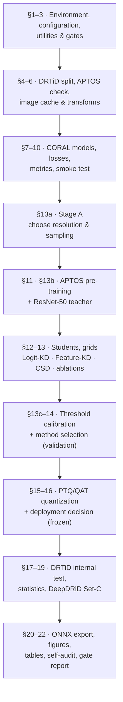

# 🧪 experiments/

[🇮🇩 Bahasa Indonesia](README.md) · **🇬🇧 English**

Everything that turns the DR-VERGE hypothesis into evidence: the notebook that was run, the supporting code, and the complete output of the final run.

```text
experiments/
├── notebooks/            the final notebook — the single source of every paper number
│   └── full_pipeline_notebook_enhanced.ipynb
├── results/              final-run outputs: tables, figures, per-sample predictions, locked configs
├── src/                  modular components: models, losses, datasets, pre-training, smoke test
├── configs/              one YAML configuration per training condition
├── scripts/              make_splits.py + verification/ (static notebook checks)
└── requirements.txt      Python dependencies
```

The separation is deliberate: **`notebooks/` is what you run, `results/` is what came out.** The outputs in `results/` are historical artifacts of a single execution and are never regenerated in place.

---

## 📓 The final notebook

| | |
|---|---|
| File | [`notebooks/full_pipeline_notebook_enhanced.ipynb`](notebooks/full_pipeline_notebook_enhanced.ipynb) |
| Run | `enhanced_v1_20260811` (**FULL RUN** mode) |
| Environment | Google Colab · NVIDIA A100-SXM4-80GB · Python 3.12 · PyTorch 2.11.0+cu128 |
| Duration | ≈ 12.5 hours |
| Status | **36/36 integrity gates passed** · **265/265 headline values** matched on recomputation |
| Selected method (M\*) | `dual_csd` (seed 3407) |
| Deployment artifact | `qat_int8` (seed 42), verified |

The notebook is **self-contained** — the whole implementation (data, models, losses, metrics, statistics, quantization, export) lives inside it, so it runs directly on Colab without importing `src/`. The full guide is in [`notebooks/README.en.md`](notebooks/README.en.md).

### Notebook flow



---

## 📂 What each folder holds

| Folder | Contents | Documentation |
|---|---|---|
| [`notebooks/`](notebooks/) | The executed final notebook with all of its outputs | [ID](notebooks/README.md) · [EN](notebooks/README.en.md) |
| [`results/`](results/) | 34 CSV tables, 14 figures (PNG + caption + data), per-sample predictions, diagnostics, locked configs | [ID](results/README.md) · [EN](results/README.en.md) |
| [`src/`](src/) | A modular version of the pipeline components (models, losses, datasets, pre-training) | [ID](src/README.md) · [EN](src/README.en.md) |
| [`configs/`](configs/) | One YAML per training condition | [ID](configs/README.md) · [EN](configs/README.en.md) |
| [`scripts/`](scripts/) | DRTiD split builder and static notebook verification scripts | [ID](scripts/README.md) · [EN](scripts/README.en.md) |

> [!NOTE]
> The configuration values **actually used** by the final run are recorded in [`results/configs/`](results/configs/) — that is the authoritative record. The YAMLs in `configs/` and the modules in `src/` are a modular version describing each condition; where they differ, `results/configs/` wins.

---

## ▶️ Running the experiment

```bash
pip install -r requirements.txt
```

1. Upload the datasets to `MyDrive/DR-VERGE/dataset/` (see [`../dataset/README.en.md`](../dataset/README.en.md)).
2. Open the notebook in Google Colab with a GPU.
3. Set `RUN_TAG`, `QUICK` and `RESUME` in the _Configuration_ cell.
4. Rehearse with `QUICK = True` on a throwaway `RUN_TAG`, then do the full run with `QUICK = False`.
5. A run finished correctly only if `artifacts_<RUN_TAG>/FINAL_RUN_COMPLETE.txt` was written.

Before committing to a multi-hour run, check the notebook statically with the scripts in [`scripts/verification/`](scripts/).

---

## 📐 Statistical protocol

Fixed before the run and applied without exception:

- **Hierarchical paired cluster bootstrap** over matched seed pairs — B = 10,000. Clusters are **eyes** internally (DRTiD has no patient IDs) and **patients** externally (DeepDRiD has them).
- **Paired permutation tests** — P = 10,000.
- **Holm correction within each family** of comparisons.
- **A difference whose 95% CI includes zero is not a claim.** When the bootstrap and the permutation test disagree — as for PTQ vs FP32 in the final run (CI includes zero, Holm p = 0.0243) — **both are reported and neither is claimed**.

---

## 🔗 Related

- Main documentation → [`../README.en.md`](../README.en.md)
- Scientific argument and mathematical derivation → [`../research/`](../research/)
- Dataset layout → [`../dataset/README.en.md`](../dataset/README.en.md)
- Web demo → [`../frontend/`](../frontend/)
