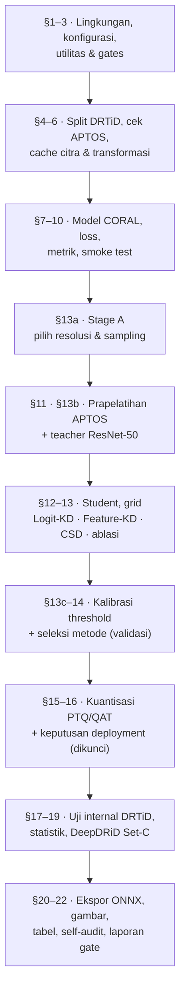

# 🧪 experiments/

**🇮🇩 Bahasa Indonesia** · [🇬🇧 English](README.en.md)

Seluruh bagian yang mengubah hipotesis DR-VERGE menjadi bukti: notebook yang dijalankan, kode pendukung, dan keluaran lengkap dari run final.

```text
experiments/
├── notebooks/            notebook final — satu-satunya sumber seluruh angka paper
│   └── full_pipeline_notebook_enhanced.ipynb
├── results/              keluaran run final: tabel, gambar, prediksi per sampel, konfigurasi terkunci
├── src/                  komponen modular: model, loss, dataset, prapelatihan, smoke test
├── configs/              konfigurasi YAML per kondisi pelatihan
├── scripts/              make_splits.py + verification/ (pemeriksaan statis notebook)
└── requirements.txt      dependensi Python
```

Pemisahannya disengaja: **`notebooks/` adalah apa yang dijalankan, `results/` adalah apa yang dihasilkan.** Keluaran di `results/` adalah artefak historis dari satu eksekusi dan tidak pernah dibuat ulang di tempat.

---

## 📓 Notebook final

| | |
|---|---|
| Berkas | [`notebooks/full_pipeline_notebook_enhanced.ipynb`](notebooks/full_pipeline_notebook_enhanced.ipynb) |
| Run | `enhanced_v1_20260811` (mode **FULL RUN**) |
| Lingkungan | Google Colab · NVIDIA A100-SXM4-80GB · Python 3.12 · PyTorch 2.11.0+cu128 |
| Durasi | ± 12,5 jam |
| Status | **36/36 _integrity gates_ lulus** · **265/265 angka utama** cocok dengan hasil hitung ulang |
| Metode terpilih (M\*) | `dual_csd` (_seed_ 3407) |
| Artefak _deployment_ | `qat_int8` (_seed_ 42), terverifikasi |

Notebook bersifat **mandiri** — seluruh implementasi (data, model, _loss_, metrik, statistik, kuantisasi, ekspor) berada di dalamnya, sehingga dapat dijalankan langsung di Colab tanpa mengimpor `src/`. Panduan lengkap ada di [`notebooks/README.md`](notebooks/README.md).

### Alur notebook



---

## 📂 Isi setiap folder

| Folder | Isi | Dokumentasi |
|---|---|---|
| [`notebooks/`](notebooks/) | Notebook final yang sudah dieksekusi beserta seluruh keluarannya | [ID](notebooks/README.md) · [EN](notebooks/README.en.md) |
| [`results/`](results/) | 34 tabel CSV, 14 gambar (PNG + _caption_ + data), prediksi per sampel, diagnostik, konfigurasi terkunci | [ID](results/README.md) · [EN](results/README.en.md) |
| [`src/`](src/) | Versi modular komponen pipeline (model, _loss_, dataset, prapelatihan) | [ID](src/README.md) · [EN](src/README.en.md) |
| [`configs/`](configs/) | Satu YAML per kondisi pelatihan | [ID](configs/README.md) · [EN](configs/README.en.md) |
| [`scripts/`](scripts/) | Pembuat _split_ DRTiD dan skrip verifikasi statis notebook | [ID](scripts/README.md) · [EN](scripts/README.en.md) |

> [!NOTE]
> Nilai konfigurasi yang **benar-benar dipakai** run final tercatat di [`results/configs/`](results/configs/) — itulah catatan otoritatif. YAML di `configs/` dan modul di `src/` adalah versi modular yang menjelaskan setiap kondisi; bila ada perbedaan, `results/configs/` yang berlaku.

---

## ▶️ Menjalankan eksperimen

```bash
pip install -r requirements.txt
```

1. Unggah dataset ke `MyDrive/DR-VERGE/dataset/` (lihat [`../dataset/README.md`](../dataset/README.md)).
2. Buka notebook di Google Colab dengan GPU.
3. Atur `RUN_TAG`, `QUICK`, dan `RESUME` pada sel _Configuration_.
4. Gladi singkat dengan `QUICK = True` pada `RUN_TAG` sementara, lalu jalankan run penuh dengan `QUICK = False`.
5. Run selesai dengan benar hanya jika `artifacts_<RUN_TAG>/FINAL_RUN_COMPLETE.txt` tertulis.

Sebelum menjalankan run yang memakan waktu berjam-jam, periksa notebook secara statis dengan skrip di [`scripts/verification/`](scripts/).

---

## 📐 Protokol statistik

Ditetapkan sebelum run dan diterapkan tanpa pengecualian:

- **_Hierarchical paired cluster bootstrap_** atas pasangan _seed_ yang sesuai — B = 10.000. Klaster adalah **mata** pada data internal (DRTiD tidak memiliki ID pasien) dan **pasien** pada data eksternal (DeepDRiD memilikinya).
- **Uji permutasi berpasangan** — P = 10.000.
- **Koreksi Holm di dalam setiap keluarga** perbandingan.
- **Selisih yang CI 95%-nya memuat nol bukan klaim.** Bila _bootstrap_ dan uji permutasi tidak sepakat — seperti PTQ vs FP32 pada run final (CI memuat nol, p Holm = 0,0243) — **keduanya dilaporkan dan tidak ada yang diklaim**.

---

## 🔗 Terkait

- Dokumentasi utama → [`../README.md`](../README.md)
- Argumen ilmiah dan turunan matematis → [`../research/`](../research/)
- Tata letak dataset → [`../dataset/README.md`](../dataset/README.md)
- Demo web → [`../frontend/`](../frontend/)
